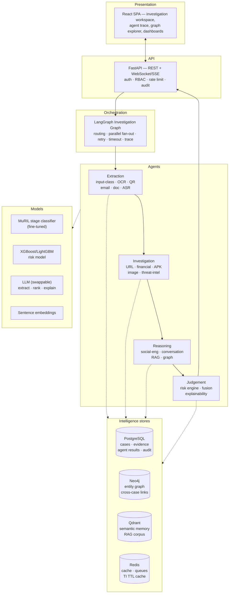
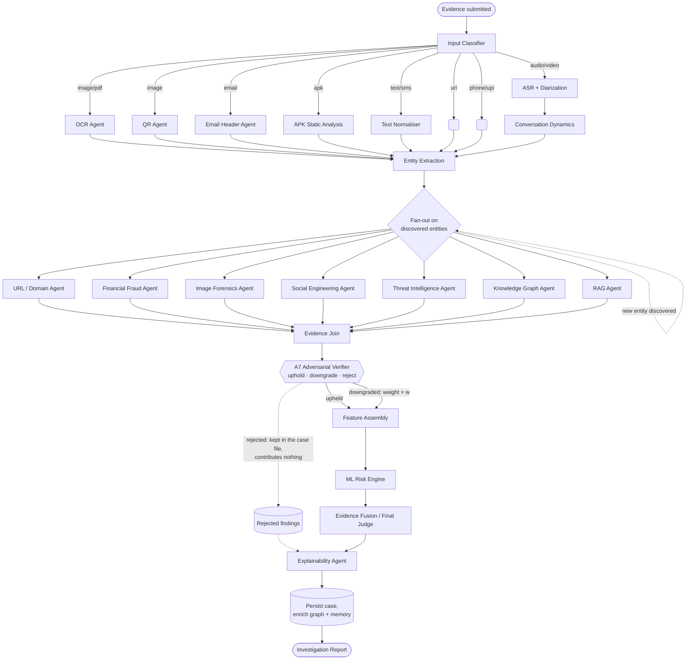
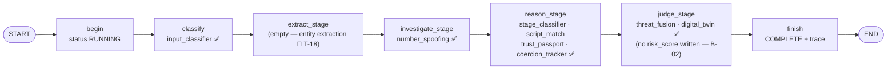
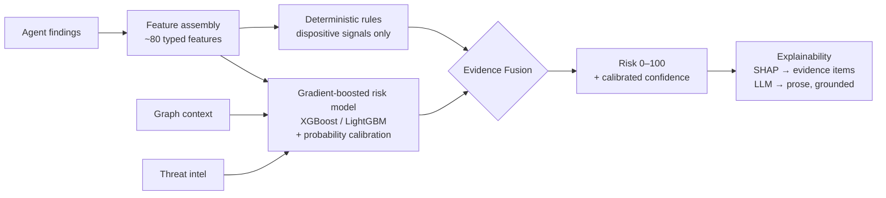
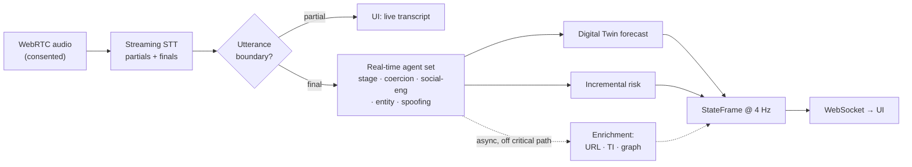
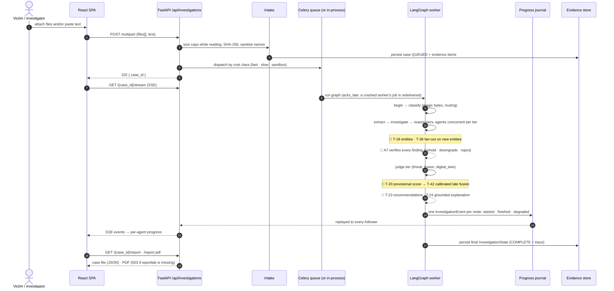
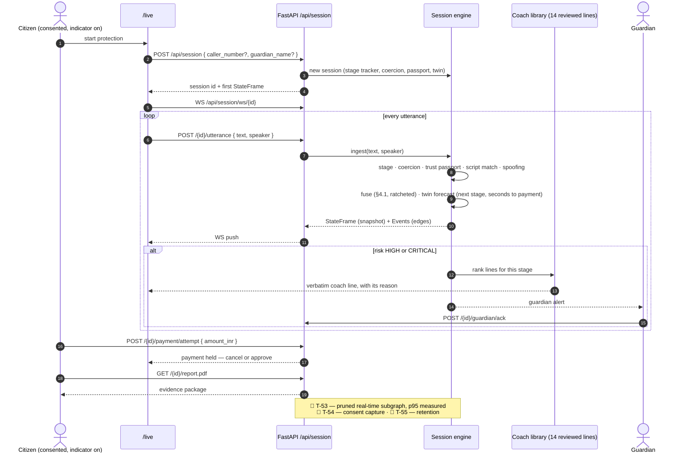

# AegisAI — System Architecture

> **AegisAI: An Agentic Digital Public Safety Platform for Autonomous
> Multi-Modal Fraud Investigation**

The central loop is never `INPUT → LLM → SCAM/NOT SCAM`. It is:

```
INPUT → EXTRACT → INVESTIGATE → CORRELATE → REASON → SCORE → EXPLAIN → ACT
```

Every design decision below serves that loop.

### How to read this document

It describes two things at once — the system **as built** and the system it is
**being built into** — and says which is which. Since T-02 (2026-10-22) every
section carries one of:

- ✅ **Built** — exists and was run (audit 2026-10-09 or a later approved task)
- 🟡 **Partial** — exists, incomplete
- 🎯 **Target** — designed, not built; the task that builds it is named
- 🅿️ **Parked** — out of scope this semester (`docs/TASKS.md`, "Parked")

The PRD (`docs/PRD.md`) states *what* the product must do; this document states
*how*. Where they meet, requirement IDs (`FR-`, `NFR-`) are cited.

---

## 0. The brief's five layers

The brief (§2) pitches five layers. The code was built in six. They are the
same system cut differently: the brief cuts by *what happens to evidence*, the
code by *where the code runs*. This is the mapping, so the pitch, the paper
and the repository tell one story.

```mermaid
flowchart LR
    subgraph ING["1 · Ingestion"]
        I1["Intake ✅<br/>caps · SHA-256 · blob store"]
        I2["Input classifier ✅<br/>magic bytes → routing"]
    end
    subgraph PER["2 · Perception"]
        P1["Text normalise ✅"]
        P2["ASR — Whisper 🟡<br/>legacy path only"]
        P3["OCR + QR 🟡<br/>legacy path only"]
        P4["Entity extraction 🎯 T-18"]
    end
    subgraph CORE["3 · Agentic core"]
        C1["LangGraph orchestration ✅"]
        C2["Specialist agents A2–A6<br/>A2 🟡 · A5 🟡 · A3, A4, A6 🎯"]
        C3["A7 adversarial verifier 🎯 T-21, T-22"]
    end
    subgraph DEC["4 · Decision"]
        D1["Fusion 🟡 hand-weighted, legacy path"]
        D2["Calibration 🎯 T-41"]
        D3["Explanation ✅ templated + LLM prose"]
        D4["Recommendations 🎯 T-23"]
    end
    subgraph PRE["5 · Presentation"]
        U1["React SPA ✅<br/>pure renderer of contract fields"]
        U2["Case file JSON + PDF 🟡"]
        U3["Live console + StateFrame WS ✅"]
    end
    ING --> PER --> CORE --> DEC --> PRE
```



| Brief layer | Code layers (§1) | Modules | Status |
|---|---|---|---|
| **1 Ingestion** | API (L1) + first graph node | `investigations/intake.py`, `agents/classify/` | ✅ |
| **2 Perception** | Agents L3 — *Extraction* tier | `ingest/asr.py`, `engine/ocr.py`, normalisation; entity extraction 🎯 | 🟡 — text only inside the graph |
| **3 Agentic core** | Orchestration (L2) + Agents L3 — *Investigation* and *Reasoning* tiers + A7 | `orchestration/`, `agents/` | 🟡 — 8 agents registered, A7 not built |
| **4 Decision** | Agents L3 — *Judgement* tier, and the scoring module (§4) | `engine/threat.py` today; `services/api/decision/` 🎯 | 🟡 — the graph writes no score yet (B-02) |
| **5 Presentation** | Presentation (L0) + API (L1) responses | `apps/web/`, `investigations/report.py` | ✅ |
| *(cross-cutting)* | Intelligence stores (L4), Models (L5) | `stores/`, `intel/`, `rag/`, `ml/` | see §1 |

The brief's **seven agents** are *roles* (PRD §6, `[ASSUMPTION]` until checked
against the synopsis), each implemented by one or more registered agents:
A1 Intake & classification · A2 Conversation & text · A3 Visual & document ·
A4 URL & infrastructure · A5 Financial & identity · A6 Intelligence ·
A7 Adversarial verifier.

---

## 1. Layered view



**Rule:** an arrow into L4/L5 may fail. Every one of them has a fallback that
still answers, and the failure is recorded in `state.degraded`.

**What runs in each box today.** The diagram is the target. As built:

| Box | Today | Status |
|---|---|---|
| PostgreSQL | Used when `DATABASE_URL` names it; SQLite otherwise | ✅ (PostgreSQL path last verified 2026-08-27; T-07) |
| Neo4j | Not used. The fraud graph is NetworkX, in process | 🅿️ |
| Qdrant | Not used. Retrieval is an in-house dense store, BM25 fallback (`rag:lexical`) | 🅿️ |
| Redis | Celery broker and progress journal; in-process fallback (`queue:in_process`) | ✅ |
| MuRIL stage classifier | Present on disk, **refused by the leak-free gate** (T-05); the lexical classifier serves | 🟡 |
| XGBoost / LightGBM risk model | Not built. Scoring is the hand-weighted fusion in §4.1 | 🎯 T-41, T-42 |
| LLM | Gemini / Ollama / Anthropic behind `llm.py`; explanations only | ✅ |
| Sentence embeddings | Multilingual sentence-transformers for retrieval | ✅ |

---

## 2. The Investigation Graph (LangGraph)

The orchestrator is a directed graph, not a pipeline. Nodes are agents; edges
are conditional on state.

### 2.1 The target graph 🎯

The graph this project is building. Nodes for parked capabilities (email
headers, APK, image forensics) are drawn because the routing is designed for
them; they are 🅿️ this semester. **A7 sits between the evidence join and
feature assembly**: every finding passes it before anything is scored.



### 2.2 The graph as it runs today ✅

`orchestration/graph.build_graph()` compiles a `StateGraph` over
`InvestigationState`. It is built from **tiers**, not from per-agent edges:
the tiers run in order and the agents inside a tier run concurrently, each
under its node policy. Measured on 2026-10-09: seven graph steps, six agents
reporting, under a second for a text message.



The step from §2.2 to §2.1 is the M2 thin slice (T-17 – T-25): entities
(T-18), a provisional score in the judge tier (T-20), A7 between reason and
judge (T-21, T-22), recommendations (T-23) and a grounded explanation (T-24).
Fan-out on discovered entities (T-36) is what turns the tier chain into the
branching graph of §2.1.

### 2.3 A7 — the adversarial verifier 🎯 (T-21, T-22)

| | |
|---|---|
| **Position** | A node between the evidence join (end of the reason tier) and the judge tier. Every finding passes it; nothing is scored before it runs |
| **Inputs** | Every `Finding` in `state.agent_results`, with its agent, confidence, source and the evidence item it came from; `state.input_types` and any `type_conflict` |
| **Outputs** | One verdict per finding, written to the contract as `Finding.verification` (T-17, built): `verdict` (`UPHELD` \| `DOWNGRADED` \| `REJECTED`), `reason`, `challenger` (`deterministic:<rule>` or `llm:<backend>`), `confidence_before`, `confidence_after` and `weight` — the multiplier the judge applies. The model refuses a raised confidence, an `UPHELD` with weight ≠ 1, a `REJECTED` with weight ≠ 0 and a `DOWNGRADED` outside (0, 1). Plus an `AgentResult` for A7 itself in the trace |
| **Deterministic challenger (T-21)** | Rules that need no model: a stage finding below `MIN_STAGE_CONFIDENCE` is downgraded; a script match whose template stage disagrees with the classifier is downgraded; a finding resting only on low-confidence extraction is downgraded; a finding from an item whose declared and detected types conflict is downgraded; a URL finding from an unguarded fetch is rejected; a cross-case link resting on one shared identifier is downgraded |
| **LLM challenger (T-22)** | Given one finding and its evidence, quoted as untrusted data, it may only *argue against* it and propose `DOWNGRADED` or `REJECTED` with a reason. It never proposes a score and never upgrades a finding. Its proposal is applied only if the deterministic challenger did not already decide |
| **Effect on the score** | `REJECTED` → weight 0, kept in the case file with its reason. `DOWNGRADED` → contribution × `weight` (0 < w < 1). `UPHELD` → unchanged (FR-42) |
| **Failure behaviour** | LLM unavailable → deterministic challenger only, `degraded: ["a7:deterministic_only"]`. A7 itself errors → every finding passes as `UPHELD`, `degraded: ["a7:unavailable"]`, and the case file says it was not verified. A7 is never allowed to block a case |
| **How it is tested** | A finding the rules must reject is rejected, and the score computed without it equals the score of the same case without that finding; a benign case's findings are not rejected into a higher score; the LLM challenger cannot raise a weight |
| **How it is evaluated** | Ablation "remove A7" (T-57): precision, false-positive rate and ECE with and without it |

### Why a graph and not a pipeline

- **Conditional execution** — an APK agent must not run on an audio file.
- **Parallel fan-out** — URL, financial, threat-intel and graph lookups are
  independent; running them concurrently is the difference between a 4 s and a
  25 s investigation.
- **Recursion with a bound** — a URL agent may discover a new domain, which
  deserves its own investigation. Depth is capped (default 2) to keep latency
  and cost bounded.
- **Reproducible traces** — every node records inputs, outputs, latency and
  degradation. That trace is simultaneously the debug tool, the UI's agent view,
  and the paper's per-agent success-rate table.

### Node execution policy

Every node runs under the same contract:

| Property | Rule |
|---|---|
| Timeout | Per-agent budget (default 8 s; TI 3 s; APK 120 s async) |
| Retry | 2 attempts, exponential backoff, only for transient/network errors |
| Failure | Never fails the investigation. Emits `AgentResult(status=DEGRADED)` and appends to `state.degraded` |
| Isolation | An agent may not read another agent's internals — only `state` |
| Determinism | Given identical state + fixed seeds + cached TI, output is reproducible |

---

## 3. `InvestigationState` — the shared contract

Master §24, made concrete and typed. Lives in `schema/` alongside the existing
`StateFrame`, and is generated to TypeScript by the same contract check.

```python
class InvestigationState(BaseModel):
    # --- identity ---
    case_id: str
    org_id: str
    created_by: str
    created_at: datetime
    mode: Literal["batch", "realtime"]

    # --- input ---
    inputs: list[EvidenceItem]           # raw uploads + typed refs
    input_types: list[InputType]         # from the classifier

    # --- extraction ---
    extracted_text: list[ExtractedText]  # text + lang + confidence + source_ref
    entities: EntitySet                  # urls, domains, phones, upi_ids,
                                         # emails, accounts, ips, apps, orgs
    transcript: Optional[Transcript]     # reuses the existing call contract

    # --- investigation ---
    agent_results: list[AgentResult]     # append-only, one per node execution
    threat_intel: list[TIRecord]         # source · timestamp · confidence · ref
    graph_context: Optional[GraphContext]# neighbours, prior cases, centrality
    rag_context: list[RetrievedChunk]    # text + citation, never invented

    # --- judgement ---
    risk_features: dict[str, float]      # the ML model's exact input vector
    risk_score: float = Field(ge=0, le=100)
    confidence: float = Field(ge=0, le=1)
    classification: Optional[FraudCategory]
    evidence: list[EvidenceFinding]      # ranked, each with confidence + source
    recommendations: list[Recommendation]

    # --- operational ---
    degraded: list[str]                  # every capability that fell back
    trace: list[TraceSpan]               # node · t_start · t_end · status
```

### `AgentResult` — every agent returns this shape

```python
class AgentResult(BaseModel):
    agent: str                    # "url_investigation"
    version: str                  # "1.3.0" — pinned for reproducibility
    status: Literal["ok", "degraded", "skipped", "error"]
    confidence: float = Field(ge=0, le=1)
    findings: list[Finding]       # each: label, value, confidence, source, detail
    features: dict[str, float]    # contribution to the ML feature vector
    latency_ms: int
    provenance: list[str]         # data sources actually consulted
    error: Optional[str]
```

This single shape is what makes the paper's *agent disagreement / confidence
analysis* possible, and what makes the UI's agent panel generic.

---

## 4. Scoring architecture — hybrid by construction

The most important design decision in the project. Master §16 is explicit: **do
not let an LLM decide the score.**

The diagram below is the 🎯 target. §4.1 is the scoring that runs today; §4.2
is the calibrated late fusion that replaces it.



Four independent scoring paths, deliberately:

1. **ML risk model** — learned, calibrated, the primary number.
2. **Deterministic rules** — floor/ceiling for genuinely conclusive signals
   (a domain registered 2 days ago hosting a login form imitating a bank).
   Kept narrow; over-use of dispositive rules is how false positives are born.
3. **Graph context** — a UPI ID seen in 4 prior confirmed cases is evidence the
   ML model cannot see from the artefact alone.
4. **LLM** — extracts structured fields, ranks findings, writes the explanation.
   **Never** produces the number.

The **Evidence Fusion** node reconciles them and, critically, records *when they
disagree*. Disagreement is a research output, not a bug.

### 4.1 Scoring today ✅ (legacy path) — `services/api/engine/threat.py`

A weighted sum of four conversational signals, plus two bounded escalators,
clamped to 0–100, with a ratchet. With `r` the classifier's stage rank
(`threat_weight × confidence`, 0 below `MIN_STAGE_CONFIDENCE`), `P` the
manipulation pressure (0–1), `C` the coercion index (0–100), `T` the trust
passport (0–100, over resolved checks), `σ` the number-spoofing risk (0–100),
and `m` the script similarity (0–1):

```text
raw  = 100 · [ 0.40·r + 0.25·P + 0.20·(C/100) + 0.15·(1 − T/100)      ← conversation, sums to 1.0
             + 0.18·(σ/100)                                            ← spoofing: escalator, capped
             + 0.15·m·[m ≥ 0.45] ]                                     ← script match: gated escalator
S_t  = max( clamp(raw, 0, 100),  S_{t−1} − 2.5·Δt )                    ← falls ≤ 2.5 points per second
band = CRITICAL ≥ 90 · HIGH ≥ 70 · ELEVATED ≥ 50 · WATCH ≥ 25 · CALM
```

Every term above 1 point is returned as a named driver, so every point is
attributable (NFR-15). A missing signal is `None`, not 0 — an absent caller
number is not scored as a clean one. The metadata escalators together cannot
lift a benign conversation into CRITICAL (FR-24). **The weights are set by
hand, and the result is not calibrated**: a 70 is not a 70% probability of
fraud. The investigation graph does not yet call this (B-02); T-20 ports it in
as a provisional judge tagged `score:uncalibrated`.

### 4.2 Calibrated late fusion 🎯 (T-39 – T-42)

Late fusion: each modality is scored on its own, each score is calibrated on
its own, and the calibrated scores are fused. Late rather than early so a
missing modality degrades the case instead of breaking the model, and so each
modality's contribution stays separately measurable — which the paper's
ablations need.

For a case with available modalities `M ⊆ {text, audio, image, transaction}`:

```text
1. Per modality, from A7-weighted findings only:
       s_m = f_m( Σ_k  v_k · x_k )                v_k = A7 weight of finding k (0, w, or 1)
2. Calibrate each modality on its own validation split:
       p_m = g_m(s_m)                             g_m = isotonic or Platt, chosen by lower ECE
3. Fuse in log-odds, over the modalities present:
       z   = b + Σ_{m ∈ M} w_m · logit(p_m)
       p   = σ(z)                                 b, w_m fit by L2 logistic regression
4. Narrow rules may set a floor, never a ceiling on evidence:
       p   = max(p, floor_rule)                   only for dispositive signals (§4, path 2)
5. Report:
       risk_score = 100 · p
       confidence = |M_reached| / |M_expected|     the fraction of expected signals that answered
       drivers    = per-finding contributions to z, attributed (NFR-15)
```

Calibration is measured with **ECE over 15 equal-width bins** and a
reliability diagram, per modality and fused, on a split built by the leak-free
split builder (T-38) — never on data the calibrator or the fusion weights were
fit on (NFR-20).

| Piece | Lives in | Fitted by | Task |
|---|---|---|---|
| Per-modality scorers `f_m` | `services/api/decision/modality.py` 🎯 | — (rules and agent features) | T-39 |
| Calibrators `g_m` | `services/api/decision/calibration.py` 🎯 | `ml/training/fit_calibration.py` 🎯 | T-41 |
| Fusion weights `b, w_m` | `services/api/decision/fusion.py` 🎯 | `ml/training/fit_fusion.py` 🎯 | T-42 |
| Fitted parameters | `ml/artifacts/fusion/` with a manifest recording the split they were fit on | — | T-41, T-44 |

`engine/threat.py` stays, as the live session's scorer and as the uncalibrated
baseline the ablation "remove calibration" compares against (T-57).

---

## 5. Real-time subgraph

Batch investigation can take 20 s. A live call cannot. The real-time path is a
**pruned subgraph** with a hard latency budget, sharing the same state contract.



- Agents in the real-time set must return in **< 400 ms p95**.
- Slow agents (URL, threat-intel, APK) run **asynchronously** and merge into a
  later frame — they never hold up a warning.
- The existing 4 Hz `StateFrame` contract is reused verbatim. This is why the
  inherited contract matters: real-time was designed in from the start.

**As built.** WebRTC capture and streaming speech-to-text are 🅿️ parked: live
intervention is demonstrated on **text utterances** posted to
`POST /api/session/{id}/utterance`, with frames pushed over
`/api/session/ws/{id}` (✅). The real-time agent set runs inside
`engine/session.py`, not yet as a pruned subgraph of the investigation graph
(🎯 T-53), and the 400 ms p95 budget is a target that has not been measured —
"real-time" is not claimed until it is (invariant 7).

---

## 6. Target repository structure

Preserves git history and the working contract; adds the agent layer.

```
aegisai/
├── apps/
│   └── web/                          # React SPA (Vite) — see ADR-0001
│       └── src/
│           ├── pages/                # investigation, graph, dashboards, admin
│           ├── components/
│           │   ├── investigation/    # launcher, progress, report
│           │   ├── agents/           # React Flow trace view
│           │   ├── graph/            # Cytoscape explorer
│           │   ├── intel/  map/  report/
│           └── types/contract.ts     # generated — never hand-edited
│
├── services/
│   ├── api/                          # FastAPI
│   │   ├── agents/                   # ── NEW: one package per agent
│   │   │   ├── base.py               #    Agent protocol + AgentResult
│   │   │   ├── registry.py
│   │   │   ├── classify/  ocr/  qr/  url/  email/  apk/  image/
│   │   │   ├── financial/  social/  threat_intel/  rag/  graph/
│   │   │   ├── risk/  fusion/  explain/
│   │   │   ├── inherited/            #    the engine below, wrapped, unchanged
│   │   ├── orchestration/            # ── NEW: LangGraph
│   │   │   ├── graph.py  nodes.py  policy.py  trace.py
│   │   ├── investigations/           # ── NEW: lifecycle — intake, runner, report
│   │   ├── jobs/                     # ── NEW: broker probe, journal, cost-class routing
│   │   ├── engine/                   # inherited call engine → conversation agents
│   │   ├── ingest/  intel/  shield/  rag/  routes/
│   │   ├── stores/                   # ── NEW: evidence + blobs; neo4j / qdrant / redis
│   │   └── tests/
│   └── worker/                       # ── NEW: Celery — fast / slow / sandbox queues
│
├── packages/
│   └── aegis_core/                   # shared domain: taxonomy, entities, Hinglish
│
├── ml/
│   ├── corpus/                       # generation, paraphrase, validation
│   ├── training/                     # stage classifier, risk model, RSSIE
│   ├── evaluation/                   # promotion gates, backend comparison
│   └── data/                         # DVC-tracked; artifacts moved out of git
│
├── research/                         # ── NEW: the paper
│   ├── experiments/                  # exp1..exp8 from RESEARCH.md
│   ├── ablations/
│   ├── notebooks/
│   ├── results/                      # committed JSON + figures
│   └── paper/
│
├── schema/                           # THE contract — Pydantic ↔ TypeScript
├── infra/
│   ├── docker/                       # Dockerfiles
│   ├── compose/                      # postgres · neo4j · qdrant · redis
│   └── seeds/
├── docs/                             # this directory
└── scripts/
```

### Migration principle

Move by `git mv`, never by copy-delete — history matters for a capstone
defence. Each move is its own commit with tests green on both sides.

---

## 7. Technology decisions

| Layer | Choice | Rationale | Today |
|---|---|---|---|
| Orchestration | **LangGraph** | Master §22. Explicit state, conditional edges, checkpointing, per-node retry. CrewAI's role-play abstraction fits poorly with deterministic non-LLM agents. | ✅ LangGraph 0.6 |
| Backend | **FastAPI + Python 3.12** | Inherited, correct, async-native. 3.9 → 3.12 is a Phase-0 blocker. | ✅ Python 3.12.14 |
| Frontend | **React + Vite (kept)** | See **ADR-0001** — deliberate deviation from the master doc's Next.js. | ✅ |
| Relational | **PostgreSQL** | JSONB for agent results, real concurrency. SQLite stays as the zero-setup fallback. | ✅ (SQLite fallback in dev) |
| Graph | **Neo4j** | See **ADR-0002**. NetworkX retained as the offline fallback. | 🅿️ NetworkX serves; Neo4j parked |
| Vector | **Qdrant** | Named preference; good filtered-search story for per-org isolation. | 🅿️ in-house dense store serves |
| Cache/queue | **Redis + Celery** | Needed the moment APK/video/TI leave the request path. Built in 1.8: three queues by cost class, `acks_late` so a crashed worker's job is redelivered, a Redis-backed progress journal so any API replica can serve the stream, and an in-process fallback tagged `queue:in_process` when no broker answers. | ✅ |
| LLM | **Provider-abstracted** | `LLMBackend` protocol. Gemini today, local Llama/Gemma supported. Never hard-coded — master §22. | ✅ |
| Embeddings | **Sentence-Transformers** (multilingual) | Must handle Hindi/Hinglish. | ✅ |
| ASR | **faster-whisper** | 4× realtime on CPU; streaming-capable. | 🟡 Whisper on the legacy path (`ingest/asr.py`) |
| OCR | **PaddleOCR** primary, Tesseract fallback | Better on Devanagari and screenshot layouts. | 🟡 Tesseract default, EasyOCR optional (`AEGIS_OCR`); PaddleOCR not used |
| Risk ML | **XGBoost + LightGBM** | Tabular, fast, SHAP-native, strong baselines for the paper. | 🎯 not built; hand-weighted fusion serves (§4.1) |
| Deploy | **Docker Compose** | Master §22 — Kubernetes explicitly not warranted. | 🟡 Render + Vercel; Compose for the dev stack |

---

## 8. Security architecture

Security is not a phase; it is a property of specific components.

| Control | Where | Why |
|---|---|---|
| **SSRF defence** | URL agent | Attacker-supplied URLs. Allowlist egress, block RFC1918 + link-local + `169.254.169.254`, re-resolve DNS after redirect, cap redirect depth, no `file://`/`gopher://`. **The single highest-risk component in AegisAI.** |
| **Malware isolation** | APK agent | Static analysis only, in a network-less container, read-only mount, resource caps. Never execute. **Not built.** 1.8 added the `sandbox` queue, which is a *cost class* and not yet a boundary: the queue is chosen at dispatch from the filename and declared MIME type, so an APK renamed `photo.jpg` runs on `fast`. 2.8 brings the container, and must enforce isolation where the sniffed type is known — inside the agent, or by re-dispatching after the classifier node — not by trusting that guess. |
| **Upload validation** | API gateway | Size cap enforced *while reading* and filename sanitisation at intake; the magic-byte type check runs on the classifier node so a declared/detected mismatch becomes a `type_conflict` finding rather than a 415 with nothing recorded. Per-org quota is not built. |
| **Tenant isolation** | Every store | `org_id` on every row, node and vector payload. Enforced in the repository layer, not the route. |
| **Secrets** | Config | Env only, never committed. Verified: no key has ever entered git history. |
| **PII minimisation** | Ingest + storage | Raw audio not retained by default; transcripts redacted before leaving the org boundary; research datasets anonymised. |
| **Consent** | Live call | Explicit gate, visible indicator, configurable retention, user-initiated deletion. |
| **Audit** | Platform | Append-only log of logins, exports, overrides, and every investigation. |
| **Rate limiting** | Middleware | Already implemented; extend per-org and per-agent (TI budget). |

---

## 9. What "done" means for any component

Per master §40.15, no component is complete until all six are answered in its
module docstring:

1. **Why** it is needed
2. **What data** it consumes
3. **What** it outputs (the typed `AgentResult`)
4. **How** it connects to other agents
5. **How** it is evaluated (which metric, on which split)
6. **What its limitations are** (stated, not hidden)

Plus, mechanically:

- [ ] Tests pass, including a false-positive case on benign input
- [ ] `schema/check_contract.py` consistent
- [ ] Frontend typecheck + build clean
- [ ] Registered in the agent registry with a version string
- [ ] Degradation path exercised by a test
- [ ] Latency recorded in the trace

---

## 10. Two flows, end to end

### 10.1 A victim submits evidence → case file

Solid arrows run today (✅). Dashed arrows and 🎯 notes are the M2 additions.



### 10.2 Live intervention during a call

Text utterances, as built (§5). The coach line is chosen from the reviewed
library and shown verbatim — a model may rank lines, never write them.



---

## 11. Two pipelines today, one tomorrow

**Today** the repository has two ways to analyse evidence, and they disagree
(audit D-01, B-02):

| | Legacy engine | Investigation graph |
|---|---|---|
| Routes | `/api/analyze/*`, `/api/session/*`, `/api/shield/*` | `/api/investigations` |
| Code | `engine/analyzer.analyze_text`, `engine/session.py` | `orchestration/graph.py` over `agents/` |
| Modalities | text, file, image (OCR + QR), audio (Whisper), UPI | text only |
| Score | ✅ hand-weighted fusion (§4.1) | ❌ none (`risk_score: null`) |
| Trace, versions, degradation per agent | partial | ✅ |
| The same Hinglish digital-arrest message | **93 CRITICAL** | **unscored**; `threat_fusion` reports ELEVATED inside it |

Both read the same engine modules — the graph's agents in `agents/inherited/`
are adapters over `engine/` — so they differ in *orchestration and
aggregation*, not in what they know.

**Tomorrow** there is one pipeline:

1. **The graph scores** (T-20), with the same fusion as the legacy path, so the
   two agree while calibration is built.
2. **The graph sees every modality** (T-26 – T-30): OCR, QR, ASR and UPI move
   from the legacy routes into graph agents.
3. **Analyze becomes a client of the graph** (T-47): `/api/analyze/*` either
   submits an investigation and waits for it, or is retired — the owner's
   decision when T-47 opens. One input, one answer, everywhere (U-04).
4. **The live session runs a pruned subgraph** of the same graph (T-53), with
   the same contract and the same agents, under a latency budget.
5. **One scoring module** (`services/api/decision/`, §4.2) is called by both
   the batch graph and the real-time subgraph.

---

## 12. Operations

| Concern | Today | Target |
|---|---|---|
| **Errors** | `HTTPException` with a string `detail`; validation errors as Pydantic's list (D-09). Codes in use: 400 401 403 404 409 413 415 422 429 503 | One envelope, `{ error: { code, message, detail, request_id } }`, on every route (T-13) |
| **Timeouts** | Per node, from `orchestration/policy.py`: default 8 s, threat intel 3 s, URL 10 s, APK 120 s. The whole investigation has a 45 s budget (`/api/health`: `budget_s`). A node that times out becomes `AgentResult(status=error)` tagged `agent:<name>:timeout`; the case still completes | Every external and LLM call has its own timeout (T-59) |
| **Retries** | Node policy: 2 attempts in total, backoff 0.25 s × 2ⁿ, **only** for transient or network errors — a retry that cannot succeed is not attempted. Queue: Celery `acks_late`, redelivery up to `AEGIS_QUEUE_MAX_RETRIES`, then the dead-letter list (`make dlq`) | — |
| **Degradation** | Every fallback records a tag in `state.degraded` / `/api/health` (`clf:lexical_fallback`, `rag:lexical`, `queue:in_process`, `ocr:unavailable`, `asr:unavailable`, `blobs:ephemeral`, `db:ephemeral`) | New dependency ⇒ new fallback ⇒ new tag (invariant 4) |
| **Logging** | No module configures `logging`; diagnostics are `print()` calls, and no request or case ID is carried (D-08) | Structured JSON logs with `request_id` and `case_id` on every line from request to agent (T-12) |
| **Observability** | A `TraceSpan` per graph node (inputs, outputs, latency, status), stored with the case; `/api/health` reports what is serving and what is degraded; the progress journal streams node events | Per-agent success rate and latency views built on the logs (T-63) |
| **Configuration** | `services/api/config.py`, one Pydantic `Settings`. Variables are `AEGIS_*` (the old `PRESAGE_*` names still read as a fallback): `AEGIS_AUTH`, `AEGIS_SECRET_KEY`, `AEGIS_TOKEN_TTL`, `AEGIS_LLM`, `AEGIS_MODEL`, `AEGIS_OCR`, `AEGIS_ARTIFACTS`, `AEGIS_REQUIRE_SERVING_BEST`, `AEGIS_DENSE_RAG`, `AEGIS_REDIS_URL`, `AEGIS_QUEUE`, `AEGIS_CORS_ORIGINS`, `AEGIS_RATELIMIT`, and `DATABASE_URL` | Model and provider choices stay config-only, so models can be swapped (brief §8) |
| **Secrets** | Environment only. `.env` is gitignored, `.env.example` lists every variable, git history has never held a key (audit S-06: rotate the local Gemini key before a public demo) | — |
